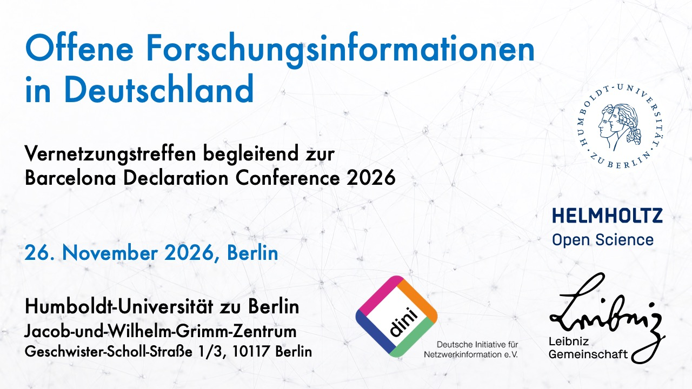

Offene Forschungsinformationen sind eine Grundlage für Transparenz, Sichtbarkeit und Nachnutzbarkeit von Forschung. In Deutschland und im gesamten DACH-Raum arbeiten viele Einrichtungen, Initiativen und Projekte an diesem Thema, oft allerdings eher nebeneinander und in unterschiedlichen Communities. **Das Vernetzungstreffen am 26. November 2026 in Berlin** soll das ändern.

Die Veranstaltung bietet Raum für Austausch und Diskussion zu offenen Forschungsinformationen in Deutschland und darüber hinaus. Eingeladen sind alle, die mit (offenen) Forschungsinformationen, Forschungsinformationssystemen (FIS), Forschungsinformationsinfrastrukturen und Metadaten zu Forschungsaktivitäten und -ressourcen arbeiten. Das gilt für die praktische Arbeit ebenso wie für Leitung, Administration, Policy und Förderung. Ziel ist es, die teilweise fragmentierten Aktivitäten und Communities besser zu vernetzen und offene Forschungsinformationen über institutionelle Grenzen hinweg voranzubringen.

Das Treffen findet direkt nach der [Conference of the Barcelona Declaration on Open Research Information](https://barcelona-declaration.org/conference_2026_berlin/) statt, die unter dem Motto Aligning Policy and Practical Implementation steht. Eine Teilnahme an der Konferenz ist ausdrücklich nicht erforderlich; die Anmeldung zum Vernetzungstreffen ersetzt allerdings auch keine Konferenzregistrierung.

**Eckdaten**

-   **Was:** Vernetzungstreffen Offene Forschungsinformationen in Deutschland

-   **Wann:** 26. November 2026, 09:00 – 13:00 Uhr

-   **Wo:** Jacob-und-Wilhelm-Grimm-Zentrum der Humboldt-Universität zu Berlin, Auditorium, Geschwister-Scholl-Straße 1/3, 10117 Berlin ([Karte](https://www.openstreetmap.org/node/13456244729))

-   **Sprache:** Deutsch

-   **Für wen:** Akteure, Einrichtungen, Initiativen und Projekte aus dem gesamten deutschsprachigen Raum (DACH)

Das Treffen wird organisiert von der [AG Forschungsinformationen & Systeme (AG FIS)](https://dini.de/fis) der [Deutschen Initiative für Netzwerkinformation e. V. (DINI)](https://dini.de/), der [Leibniz-Gemeinschaft](https://www.leibniz-gemeinschaft.de/), dem [Helmholtz Open Science Office](https://os.helmholtz.de/) und der [Humboldt-Universität zu Berlin](https://www.ibi.hu-berlin.de/de/forschung/infomanagement).

**Anmeldung**

Wir freuen uns auf einen Vormittag voller Austausch und neuer Kontakte. Ein vorläufiges Programm und die Möglichkeit zur Anmeldung finden Sie [hier](https://events.hifis.net/event/4638/).

------------------------------------------------------------------------

Weitere Informationen zu unserem Lehrstuhl finden Sie auf unserer [offiziellen Website](http://hu.berlin/infomgnt).

Dieser Text – mit Ausnahme von Zitaten und anderweitig gekennzeichneten Teilen – steht unter der [CC BY 4.0 DEED](https://creativecommons.org/licenses/by/4.0/deed.de).
