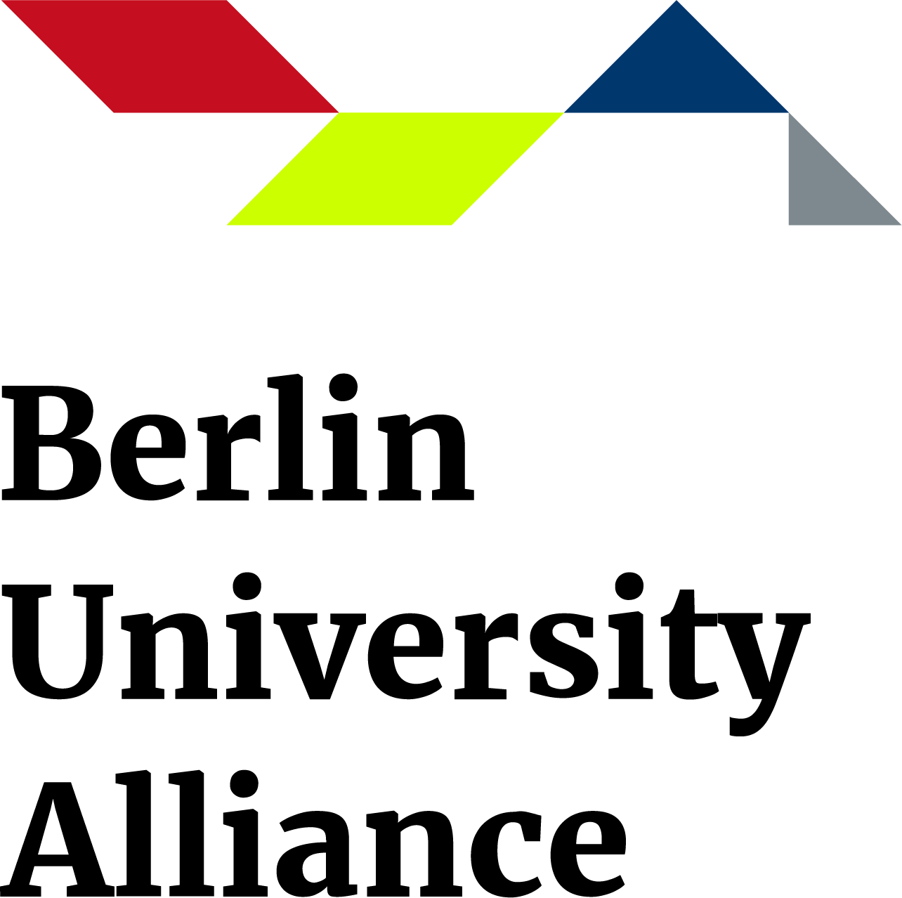

{fig-height="60%" fig-align="center" width="350"}

The Berlin University Alliance (BUA) brings together Humboldt-Universität zu Berlin, Freie Universität Berlin, Technische Universität Berlin, and Charité–Universitätsmedizin Berlin, with the aim of jointly creating and shaping a research space in Berlin. Recently, the Excellence Commission decided to [continue funding BUA as a University Consortium of Excellence](https://www.berlin-university-alliance.de/en/excellence-strategy/index.html), which makes this a good moment to revisit our research projects that were supported by the BUA.

The research group Information Management at the [Berlin School of Library and Information Science](https://www.ibi.hu-berlin.de/en) (IBI) has taken part in two BUA programs: the BUA Fellowships and the Open Science Ambassadors. Both belong to the alliance’s [Objective 3: Advancing Research Quality and Value](https://www.berlin-university-alliance.de/commitments/research-quality/index.html). In the following, we will present the BUA activities of the research group in more detail.

## BUA Fellowships

The [BUA Fellowships](https://www.berlin-university-alliance.de/commitments/research-quality/forschung/fellowship/index.html) support researchers who want to work on questions of research quality and open science (OS). Incoming fellows come to Berlin to work with researchers at BUA institutions, while outgoing fellows take their projects abroad to a host institution. In both cases, the aim is to build networks and produce results that benefit the wider OS community. The research group Information Management has been involved in four fellowships so far.

### **Incoming: Jens Klump on Versioning Research Data**

In 2024, [Jens Klump](https://people.csiro.au/K/J/jens-klump), researcher at the [Commonwealth Scientific and Industrial Research Organisation](https://www.csiro.au) and president of the [International Generic Sample Number Organisation](https://ev.igsn.org/home) (IGSN), spent three months with us as an incoming fellow. While at IBI, he worked on questions concerning the versioning of research data: what counts as a new version, and how should it be identified, cited, and documented? During the fellowship, Jens held a workshop with participants from the BUA and other institutions who shared their experiences, which provided us with a good overview of current practice [@klump2024blogpost]. Building on the results of the workshop, Jens developed a reference model for data versioning and published it as a practical guide, with the workshop materials and report on Zenodo [@klump2024guide]. Finally, the article “What do we mean by ‘version’? Actionable guidelines for the versioning of data” has just been published in the Data Science Journal [@klump2026paper] as a result of this Australian-German cooperation.

### **Incoming: Stefanie Haustein on Article Processing Charges**

In 2025, [Stefanie Haustein](https://uniweb.uottawa.ca/view/profile/members/2846) of the [University of Ottawa](https://www.uottawa.ca/en), who is also a co-director of the [ScholCommLab](https://www.scholcommlab.ca/), came to IBI as an incoming fellow. Together with a team of researchers, librarians, and students, she worked on the [ROARA project](https://www.scholcommlab.ca/research/roara/), where they built a dataset of article processing charges (APCs) to support estimates of global APC expenditure. The work, to which Jonas Höfting and Lisa Matthias of our research group contributed alongside others, resulted in an open dataset [@matthias2026APCdata], a data paper describing it [@matthias2026APCdatapaper], and a paper estimating global APC expenditure [@matthias2026APCpreprint].

### **Outgoing: Dorothea Strecker on Metadata Flows**

Dorothea Strecker’s outgoing fellowship in 2025 took her to [University of Ottawa](https://www.uottawa.ca/en), where she worked with [Stefanie Haustein](https://uniweb.uottawa.ca/view/profile/members/2846), who also supervises her dissertation. In Ottawa, she worked on the question of how metadata travel from research data repositories to DataCite, and whether information gets lost along the way. The project asked whether the missing details in DataCite records could be improved by better mappings between metadata schemas, which would make research data more visible in the scholarly record. Dorothea has published the results in a preprint [@strecker2026preprint] and written about the stay in a blog post [@strecker2025blogpost].

### **Outgoing: Lisa Matthias on Diamond Open Access**

Lisa Matthias's outgoing fellowship in 2026 took her to [Simon Fraser University](https://www.sfu.ca/) in Canada. She worked with [Juan Pablo Alperin](https://www.sfu.ca/publishing/master-of-publishing/faculty-and-staff/juan-pablo-alperin.html), Scientific Director of the [Public Knowledge Project](https://pkp.sfu.ca/) and also a co-director of the [ScholCommLab](https://www.scholcommlab.ca/), and [Mikael Laakso](https://mikaellaakso.com/), Associate Professor in Information Studies at [Tampere University](https://www.tuni.fi/en), on diamond fractures: journals that were free to readers and authors and later moved to a subscription or APC-based model. To identify such cases, the team combined and cross-checked several data sources, resulting in a dataset of 440 journals that changed their model between 2009 and 2026. Lisa and her co-authors published a preprint [@matthias2026diamondpreprint] and the dataset [@matthias2026diamonddata]. The research also received attention in a recent Nature article [@singh2026] and in [University World News](https://www.universityworldnews.com/post.php?story=20261030130035677).

## BUA Open Science Ambassadors

The [BUA Open Science Ambassador program](https://www.berlin-university-alliance.de/en/commitments/research-quality/open-science/Leitbild-fuer-OS/index.html) aims to put OS into everyday research. The ambassadors serve as first contacts for colleagues in faculties, departments, clusters of excellence, and research institutes. They show researchers, students, and decision-makers how open science can benefit them, and they contribute to subject-specific discussions in various formats. Recently, members of our research group have started a term as BUA Open Science Ambassadors for the third time.

In their first term, ambassadors [Dorothea Strecker](https://infomgnt.org/members/Dorothea_Strecker/) and [Catharina Ochsner](https://infomgnt.org/members/Catharina_Ochsner/) organized a two-day [Carpentries](https://carpentries.org/) workshop on how to use [LaTeX](https://www.latex-project.org/) for academic publishing. The workshop was led by [Lukas Bossert](https://www.dkz2r.de/participants/lukas-bossert/) from [RWTH Aachen](https://www.rwth-aachen.de/go/id/a/) and the [Rhine-Ruhr Center for Scientific Data Literacy](https://www.dkz2r.de/) (DKZ.2R). It included an introduction to LaTeX and key features such as inserting figures, tables, and bibliographies using the TeXstudio editor.

In their second term, Dorothea Strecker and Catharina Ochsner organized a writing retreat for 16 doctoral researchers in the Faculty of Philosophy at Humboldt-Universität. The writing retreat was led by [Kaitlin Montague](https://www.researchgate.net/profile/Kaitlin-Montague-3), while the ambassadors introduced open science publishing to the doctoral students. In addition to working on their own text, participants discussed writing strategies and OS practices.

Since October 2026, Dorothea Strecker and Jonas Höfting have taken over as the new tandem. They plan a second iteration of the writing retreat in spring 2027, combining focused writing time and networking with input on academic writing and on open science topics specific to the humanities.

## Conclusion

Versioning guidelines, APCs, metadata flows, diamond open access journals, a writing retreat for doctoral researchers, and training in LaTeX, academic writing, and open science publishing may look unrelated, but they all serve BUA’s Objective 3 of advancing research quality and value. The fellowships brought outside expertise to our research group and took our questions abroad, thus strengthening international networks and creating room for new ideas. The ambassador program, in turn, carries this knowledge into the BUA, and especially into the Faculty of Philosophy: members of our research group receive funding to run their own training sessions and to offer others space to write together, talk through shared problems, and learn about open science.

For the research group Information Management, the BUA is most valuable in exactly this way: it gives us the time, the contacts, and the space to turn research questions into work that we and others can build on. It allows us to deepen existing collaborations and build new ones with colleagues across the BUA institutions, throughout Berlin, across Germany, and even on other continents, thereby strengthening the quality and impact of our research. We’re excited about what comes next: a new ambassador tandem and, possibly, new fellows, both incoming and outgoing.

------------------------------------------------------------------------

Further information about the research group can be found on our \[official website\](http://hu.berlin/infomgnt).

This text – excluding quotes and otherwise labelled parts – is licensed under the \[CC BY 4.0 DEED\](<https://creativecommons.org/licenses/by/4.0/deed.de>).

---
nocite: |
  @*
---